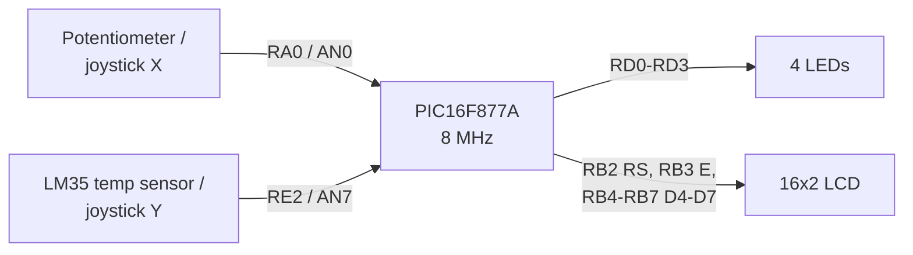
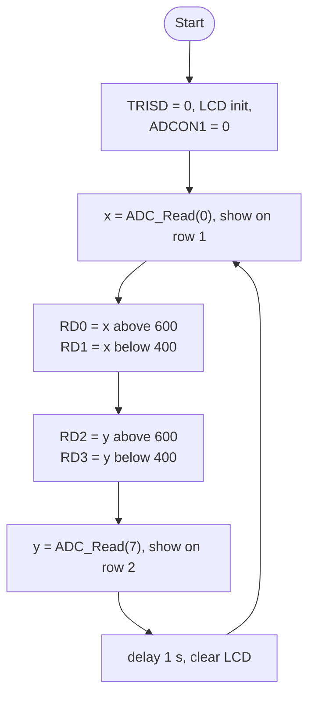

# Microcontroller-ADC

A step-by-step lab series on the **10-bit Analog-to-Digital Converter** of the PIC16F877A. It starts by printing a raw value and builds up to a temperature sensor and a 2-axis joystick that drives LEDs. All results are shown on a 16×2 LCD.

## Target hardware & settings

| Setting | Value |
|---|---|
| Microcontroller | **PIC16F877A** (10-bit ADC, 8 channels AN0–AN7) |
| Clock | 8 MHz crystal (HS) |
| Compiler / IDE | mikroC PRO for PIC (`Lcd`, `ADC`, `Conversions`) |
| ADC setup | `ADCON1 = 0b00000000`: all of AN0–AN7 analog, Vref+ = VDD (5 V), Vref− = VSS |
| Config word | `0x2F4A`: HS oscillator, WDT off, PWRT off, BOR on, LVP off, no code protection |

## Wiring (common to all sub-projects)

| Signal | Pin |
|---|---|
| Analog input 1 (pot / joystick X) | RA0 / **AN0** |
| Analog input 2 (temperature / joystick Y) | RE2 / **AN7** |
| LEDs | RD0–RD3 |
| LCD RS / E / D4–D7 | RB2 / RB3 / RB4–RB7 |

**Useful numbers:** one ADC step = 5 V / 1023 ≈ **4.89 mV**. An LM35 outputs 10 mV/°C, so `raw / 2` gives roughly the temperature in °C. That's why the code divides AN7 by 2.

## Sub-projects

| Folder | What it does |
|---|---|
| `test before lab/` | LCD check before the lab: prints "sari" / "abu qoura" (same as the LCD project). |
| `ADC0/` | Reads **AN0** and shows the raw value **0–1023** on the LCD in a loop. |
| `ADC1/` | Same as ADC0, plus a **threshold**: RD0 turns on when raw > 500 (about 2.44 V). |
| `ADC2/` | **4-step bar graph**: RD0 > 250, RD1 > 500, RD2 > 750, RD3 > 1000. More LEDs light as the pot turns. |
| `ADC3/` | **Voltmeter**: converts AN0 to volts (`raw × 5 / 1023`) and shows e.g. `3.21`, refreshing every 1 s. |
| `ADC4/` | **Thermometer**: reads the LM35 on **AN7** and shows `raw / 2` ≈ °C. |
| `ADC5/` | **Both at once**: temperature (AN7 / 2) on row 1 and pot voltage (AN0) on row 2, every 1 s. |
| `ADC6/` | **Joystick readout**: X axis (AN0) on row 1 and Y axis (AN7) on row 2, raw 0–1023. |
| `ADC7/` | **Joystick → LEDs**: X > 600 → RD0, X < 400 → RD1, Y > 600 → RD2, Y < 400 → RD3 (≈ right/left/up/down). Values 400–600 are the centre dead-zone. |

### Program flow (`ADC7`, the most complete one)

### Notes
- In `ADC7`, Y is compared **before** it is read, so the Y LEDs react one loop (1 s) late. Moving `yvalue = ADC_Read(7);` above the `if`s fixes this.
- In `ADC5`, the line `tmptxt[4];` does nothing. It was probably meant to be `tmptxt[4] = 0;` to shorten the string.

## Build & flash
Open the `.mcppi` file of a sub-project in mikroC PRO for PIC, build, and flash the `.hex`.
